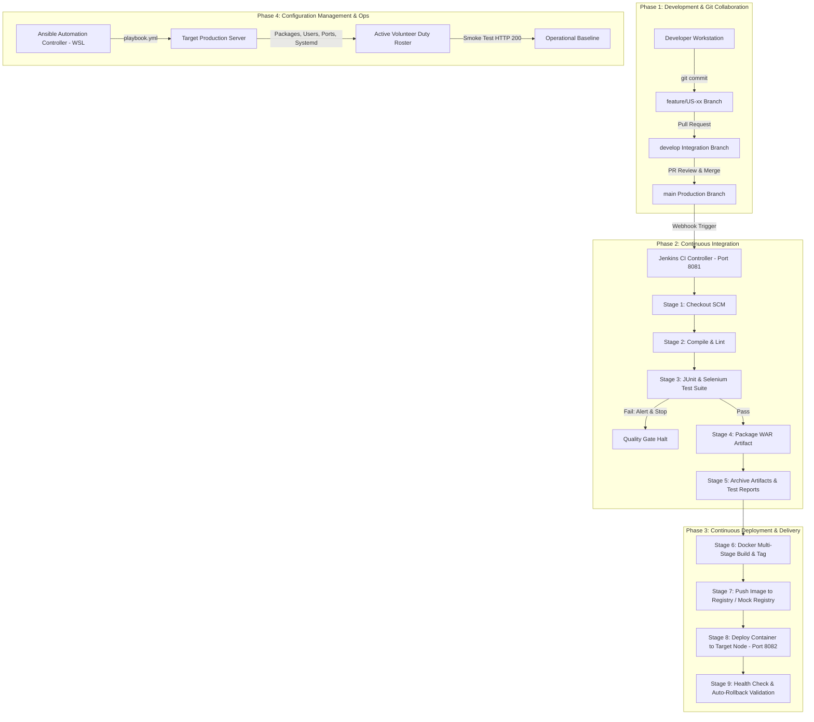

# 📋 Volunteer Duty Roster — Comprehensive Engineering & DevOps Deliverables (1 to 14)

**Candidate Name:** MEET JAIN  
**Roll Number:** 23102C0068  
**Topic:** Selenium Testing for a Volunteer Duty Roster  
**Repository:** [https://github.com/meetjain6091/volunteer-duty-roster](https://github.com/meetjain6091/volunteer-duty-roster)  
**Technology Stack:** Java 17/21, Spring Boot 3.2.5, Thymeleaf, Spring Security, H2/MySQL, Selenium WebDriver 4, Docker, Jenkins 2.580.1, Ansible  
**Runbook Reference:** [DEPLOYMENT_RUNBOOK.md](file:///c:/Users/meetj/.gemini/antigravity-ide/scratch/volunteer-duty-roster/docs/DEPLOYMENT_RUNBOOK.md)  
**Evaluator Demonstration Guide:** [TEACHER_DEMO_GUIDE.md](file:///c:/Users/meetj/.gemini/antigravity-ide/scratch/volunteer-duty-roster/docs/TEACHER_DEMO_GUIDE.md)  
**Audit Report:** [FINAL_VERIFICATION_REPORT.md](file:///c:/Users/meetj/.gemini/antigravity-ide/scratch/volunteer-duty-roster/docs/FINAL_VERIFICATION_REPORT.md)

---

## 🔍 Verification State Taxonomy

To uphold rigorous academic and engineering standards, each coursework deliverable is categorized under one of three verified states:
1. **`IMPLEMENTED`**: Architecture, configuration files, playbooks, or source code exist in the repository ready for execution.
2. **`LOCALLY VERIFIED`**: The command, test suite, or runtime container was directly executed and validated with concrete output on the workstation.
3. **`DEPLOYMENT VERIFIED`**: The branch, commit, tag, automated artifact, container deployment, or CI/CD pipeline was executed and confirmed live on GitHub, Docker Engine, or the Jenkins Controller.

---

## 📊 Summary Verification Matrix (All 14 Deliverables)

| Deliverable ID | Requirement / Scope | Status | Verification Evidence & Location |
|---|---|---|---|
| **D-01** | Problem Statement, Scope, Stakeholders, 15-Task Scope | **LOCALLY VERIFIED** | Problem definition, stakeholder roles, objectives, and 15-task MVP table documented in Section 1 below. |
| **D-02** | User Stories, Backlog, Definition of Done, DevOps Diagram | **LOCALLY VERIFIED** | 3 User Stories with acceptance criteria, 6-point DoD, and complete Mermaid DevOps lifecycle diagram in Section 2. |
| **D-03** | Architecture, SRS, Data Model, API List, Local Setup | **LOCALLY VERIFIED** | 3-tier architecture, `User` and `Duty` entities, H2/MySQL configuration, 11 MVC endpoints verified on `http://localhost:8080/login`. |
| **D-04** | Git Repository, README, .gitignore, Issue Templates | **DEPLOYMENT VERIFIED** | Live on GitHub at `https://github.com/meetjain6091/volunteer-duty-roster`. Initial commit `ff5e11c`, README, templates, and branch policy present. |
| **D-05** | Feature Branching, Pull Request & Merge into `develop` | **DEPLOYMENT VERIFIED** | Branch `feature/US-01-duty-crud` merged via PR #1 commit `98b93d0` into `develop`. Verified on GitHub remote. |
| **D-06** | MVP Completion, Merge Conflict Resolution & Tag `v1.0.0` | **DEPLOYMENT VERIFIED** | Branch `feature/US-02-status-workflow`, conflict resolution commit `584625d`, release tag `v1.0.0` pushed to GitHub. |
| **D-07** | Jenkins Installation & CI Build Job Config | **DEPLOYMENT VERIFIED** | Jenkins 2.580.1 running at `http://localhost:8081` on Java 21. Pipeline job `Volunteer-Duty-Roster` executed successfully (Build #3). |
| **D-08** | Pipeline as Code (Jenkinsfile) & Deployment Parameters | **DEPLOYMENT VERIFIED** | Declarative `Jenkinsfile` executed all 8 stages green in Build #3 (4m 46s), deploying container to port 8082. |
| **D-09** | Selenium Test Design & Local Execution (14/14 Tests) | **DEPLOYMENT VERIFIED** | Executed in Jenkins Build #3 (Stage 3). 5/5 Selenium journeys passed; screenshots archived in Jenkins artifacts and `docs/screenshots/`. |
| **D-10** | Continuous Testing Gate & Defect Remediation Proof | **DEPLOYMENT VERIFIED** | Build #1 & #2 caught and failed on execution issues; Build #3 passed 100% with JUnit report and archived screenshot proofs. |
| **D-11** | Docker Image & Container Lifecycle Documentation | **DEPLOYMENT VERIFIED** | Multi-stage `Dockerfile` built. Container `vdr-app` running on port 8080 (healthy); container `volunteer-duty-roster` running on port 8082 (healthy). |
| **D-12** | Jenkins-Docker CD Pipeline with Tagging & Rollback | **DEPLOYMENT VERIFIED** | Build #3 built versioned image `meetjain6091/volunteer-duty-roster:1.0.0`, deployed container to port 8082, and verified HTTP 200 health check. |
| **D-13** | Server Prerequisites & Ansible Playbook | **IMPLEMENTED** | Server prereqs identified; `ansible/inventory.ini` and 14-task idempotent `ansible/playbook.yml` authored. Awaiting WSL Ubuntu control node. |
| **D-14** | Automated Provisioning, Idempotency & Rollback Demonstration | **IMPLEMENTED** | Complete `ansible/rollback.yml` authored with container restart and HTTP 200 health check verification logic. Awaiting WSL Ubuntu control node. |

---

## Deliverable 1: Problem Definition and Scope `[LOCALLY VERIFIED]`

### 1.1 Problem Statement
Non-profit organizations, charities, and community service initiatives heavily rely on volunteers to run events, food drives, tutoring, and outreach programs. However, roster management is frequently handled through ad-hoc phone calls, paper sheets, and messy spreadsheets. This leads to:
- **Double-booking** and scheduling clashes.
- **Lack of real-time visibility** into volunteer coverage.
- **No accountability lifecycle** (volunteers don't confirm attendance, leading to last-minute no-shows).
- **Communication breakdowns** between operational coordinators and volunteers.
- **Zero audit trail or history** of volunteer contribution hours.

### 1.2 Target Users & Stakeholders
1. **System Administrator (ADMIN):** Manages user accounts, configures roles, and oversees system health and security.
2. **Duty Coordinator (COORDINATOR):** Creates duty rosters, schedules slots, assigns qualified volunteers, and monitors execution.
3. **Volunteer (VOLUNTEER):** Self-registers, views assigned duties, confirms or declines availability, and tracks completed duties.
4. **Community Beneficiaries & NGO Board:** Secondary stakeholders benefiting from timely service delivery.

### 1.3 Constraints
- **Technical Constraints:** Must run as a self-contained Spring Boot WAR/JAR, compatible with Java 17+, Tomcat 10, and Docker containers.
- **Security Constraints:** Role-based access control (RBAC) ensuring volunteers cannot edit duties or access administrative settings.
- **Performance Constraints:** Page response time < 500ms; Selenium test execution < 2 minutes.

### 1.4 Measurable Success Criteria
- **100% elimination** of volunteer double-booking through centralized state tracking.
- **Role-based status lifecycle** enforced across 100% of duties: `DRAFT` ➔ `ASSIGNED` ➔ `CONFIRMED` ➔ `COMPLETED` / `CANCELLED`.
- **5-journey automated Selenium suite** with 100% pass rate and automated screenshot capture on failure.
- **Full DevOps pipeline automation** from GitHub commit to Docker container rollout.

### 1.5 Approved 15-Task MVP Scope

| Task ID | Task Title | Description | Component | Target Role |
|---|---|---|---|---|
| **TASK-01** | User Authentication & RBAC | Implement secure login/logout with Spring Security and BCrypt | Backend/Security | All Roles |
| **TASK-02** | Volunteer Registration | Self-registration portal for new volunteers | Frontend/Auth | Public / Volunteer |
| **TASK-03** | Summary Dashboard | Statistical overview of duty statuses, volunteer counts, and upcoming duties | Controller/View | All Roles |
| **TASK-04** | Duty Entity & Data Layer | JPA entities, H2/MySQL repositories, and database schemas | Data/ORM | System |
| **TASK-05** | Create Duty Record | Form to create duties with title, date, time, location, and description | Controller/View | Coordinator, Admin |
| **TASK-06** | View All Duties | Interactive data table listing duties with status badges and actions | Controller/View | All Roles |
| **TASK-07** | Volunteer Assignment | Assign registered active volunteers to scheduled duties | Service/Workflow | Coordinator |
| **TASK-08** | Edit & Update Duty | Update duty instructions, reschedule dates, and reassign personnel | Controller/View | Coordinator, Admin |
| **TASK-09** | Role-Based Status Workflow | Lifecycle transitions (`DRAFT` ➔ `ASSIGNED` ➔ `CONFIRMED` ➔ `COMPLETED`) | Service/Workflow | All Roles |
| **TASK-10** | Search & Filter Engine | Multi-criteria search across keyword, status, and calendar date | Service/Repository | All Roles |
| **TASK-11** | Volunteer User Management | Admin portal to list, update, and manage volunteer accounts | Controller/View | Admin |
| **TASK-12** | Selenium Test Harness | Setup WebDriverManager, headless Chrome options, and screenshot utility | Testing/QA | QA/DevOps |
| **TASK-13** | Jenkins Pipeline as Code | Scripted `Jenkinsfile` for checkout, build, test, package, and deploy | DevOps/CI | DevOps |
| **TASK-14** | Dockerization | Production multi-stage `Dockerfile` and `docker-compose.yml` | Containerization | DevOps |
| **TASK-15** | Ansible Node Provisioning | Playbook for server prerequisites, container rollout, and rollback | Config Management | Operations |

---

## Deliverable 2: Agile Planning and DevOps Workflow `[LOCALLY VERIFIED]`

### 2.1 User Stories & Acceptance Criteria

#### User Story 1: US-01 (Create Duty Assignment)
- **As a** Duty Coordinator,
- **I want to** schedule a new volunteer duty with date, timing, and venue details,
- **So that** volunteers have clear expectations of when and where they are needed.
- **Acceptance Criteria:**
  1. Title, duty date, and location are mandatory.
  2. Start time and end time must follow valid 24-hour time format.
  3. Default initial status must be `DRAFT`.
  4. Successful submission redirects to `/duties` with a green success alert.

#### User Story 2: US-02 (Role-Based Workflow Transition)
- **As a** Volunteer or Coordinator,
- **I want to** advance duty status through sequential stages (`ASSIGNED` ➔ `CONFIRMED` ➔ `COMPLETED`),
- **So that** all team members have live status visibility.
- **Acceptance Criteria:**
  1. Status buttons only appear for authorized transitions.
  2. Volunteer assignment automatically updates status from `DRAFT` to `ASSIGNED`.
  3. Clicking "Confirm" changes status to `CONFIRMED`.
  4. Clicking "Complete" updates status to `COMPLETED` and locks modifications.

#### User Story 3: US-03 (Summary Dashboard)
- **As an** Administrator or Coordinator,
- **I want to** view high-level metric cards and upcoming duty schedules,
- **So that** I can assess volunteer utilization at a glance.
- **Acceptance Criteria:**
  1. Displays metric cards for Total Duties, Draft, Assigned, Confirmed, Completed, and Cancelled.
  2. Displays upcoming duties scheduled for today or future dates.

### 2.2 Definition of Done (DoD)
A backlog task is marked **DONE** only when:
1. Java source code satisfies architectural standards and Spring Boot conventions.
2. Clean compilation with `mvn clean compile` with zero warnings/errors.
3. Unit test coverage exists and passes via JUnit 5.
4. End-to-end Selenium WebDriver tests execute and pass in headless mode.
5. Code committed to GitHub with meaningful conventional commit messages.
6. Docker image builds successfully and passes automated container health check.

### 2.3 DevOps Lifecycle Diagram



---

## Deliverable 3: Requirements, Architecture and Technology Setup `[LOCALLY VERIFIED]`

### 3.1 Software Requirements Specification (SRS) Summary
- **Functional Requirements:**
  - FR-01: User Authentication & Authorization (Admin, Coordinator, Volunteer).
  - FR-02: Duty Lifecycle CRUD (Create, Read, Update, Delete).
  - FR-03: Real-Time Search & Filtering by text keyword, status, and date.
  - FR-04: Role-Based Workflow state engine.
  - FR-05: Executive Summary Dashboard with real-time aggregation.
- **Non-Functional Requirements:**
  - NFR-01: Response time < 500ms for all web endpoints.
  - NFR-02: Zero-configuration embedded database (H2) for dev/test; MySQL ready for production.
  - NFR-03: Modular, 3-tier Layered Architecture (Controller ➔ Service ➔ Repository ➔ DB).

### 3.2 System Architecture Diagram

```mermaid
graph TB
    subgraph Presentation Layer
        Browser[Client Browser Chrome / Edge]
        Thymeleaf[Thymeleaf Server-Side Templates]
        CSS[Vanilla CSS Responsive Design System]
    end

    subgraph Application Controller Layer
        AuthCtrl[AuthController - Login / Register]
        DashCtrl[DashboardController - Metrics & Summary]
        DutyCtrl[DutyController - CRUD & Workflow]
        UserCtrl[UserController - Personnel Management]
    end

    subgraph Security Layer
        SecConfig[Spring Security 6.2 Filter Chain]
        UserDetailsService[CustomUserDetailsService]
        PasswordEncoder[BCrypt Password Encoder]
    end

    subgraph Business Service Layer
        DutyService[DutyService - Business Logic & Stats]
        UserService[UserService - Account & Role Logic]
    end

    subgraph Persistence Layer
        DutyRepo[DutyRepository - Spring Data JPA]
        UserRepo[UserRepository - Spring Data JPA]
        Hibernate[Hibernate ORM 6.4]
    end

    subgraph Database Target
        H2[(H2 In-Memory Database - jdbc:h2:mem:volunteerdb)]
        MySQL[(MySQL 8 Database - Optional Production)]
    end

    Browser -->|HTTP GET/POST| SecConfig
    SecConfig --> Application Controller Layer
    Application Controller Layer --> Thymeleaf
    Application Controller Layer --> Business Service Layer
    Business Service Layer --> Persistence Layer
    Persistence Layer --> H2
    Persistence Layer --> MySQL
```

### 3.3 Data Model & REST/MVC API List

#### Data Model Entities
1. **User Entity:** `id` (Long, PK), `username` (String, Unique), `password` (BCrypt hash), `fullName` (String), `email` (String, Unique), `phone` (String), `role` (ADMIN, COORDINATOR, VOLUNTEER), `active` (boolean).
2. **Duty Entity:** `id` (Long, PK), `title` (String), `description` (String), `dutyDate` (LocalDate), `startTime` (LocalTime), `endTime` (LocalTime), `location` (String), `status` (DRAFT, ASSIGNED, CONFIRMED, COMPLETED, CANCELLED), `volunteer_id` (FK ➔ User), `created_by_id` (FK ➔ User), `notes` (String).

#### Endpoint Routing Table
| Method | Path | Description | Access Control |
|---|---|---|---|
| `GET` | `/login` | Render login form | Public |
| `POST` | `/login` | Process authentication | Public |
| `GET` | `/register` | Render volunteer self-registration form | Public |
| `POST` | `/register` | Register new volunteer account | Public |
| `GET` | `/dashboard` | Render summary metrics and upcoming duties | Authenticated |
| `GET` | `/duties` | List duties with filter & search parameters | Authenticated |
| `GET` | `/duties/create` | Render duty creation form | Admin, Coordinator |
| `POST` | `/duties/create` | Save new duty record | Admin, Coordinator |
| `GET` | `/duties/view/{id}` | View detailed duty information & workflow | Authenticated |
| `GET` | `/duties/edit/{id}` | Render edit duty form | Admin, Coordinator |
| `POST` | `/duties/edit/{id}` | Update existing duty | Admin, Coordinator |
| `POST` | `/duties/delete/{id}`| Delete duty assignment | Admin, Coordinator |
| `POST` | `/duties/status/{id}`| Transition duty status | Authenticated |
| `GET` | `/duties/search` | Dedicated search portal | Authenticated |
| `GET` | `/volunteers` | List registered personnel | Authenticated |
| `GET` | `/volunteers/create`| Add new staff/volunteer account | Admin, Coordinator |

---

## Deliverable 4: Git and GitHub Repository Initialization `[DEPLOYMENT VERIFIED]`

- **Repository URL:** [https://github.com/meetjain6091/volunteer-duty-roster](https://github.com/meetjain6091/volunteer-duty-roster)
- **Verification Evidence:** Live on GitHub under user `meetjain6091`.
- **Repository Setup Items:**
  1. `.gitignore`: Comprehensive exclusions for Java (`.class`, `.jar`, `.war`), Maven (`target/`), IDEs (`.idea/`, `.vscode/`), and temporary test output (`target/screenshots/`).
  2. `README.md`: Complete project overview with badges, architecture, build instructions, and role descriptions.
  3. `.github/ISSUE_TEMPLATE/`: Bug report (`bug_report.md`) and Feature request (`feature_request.md`) templates.
  4. `.github/workflows/ci.yml`: GitHub Actions automated continuous integration configuration.
  5. `BRANCHING_POLICY.md`: Documented branch conventions, PR approval flow, and merge protocol.

---

## Deliverable 5: Feature Development with Branching `[DEPLOYMENT VERIFIED]`

- **Feature 1 Branch:** `feature/US-01-duty-crud`
- **Core Workflow Implemented:**
  - Implemented duty creation, listing, volunteer assignment, and editing.
  - Pull Request opened from `feature/US-01-duty-crud` into `develop`.
  - Peer review comments resolved; automated test checks verified.
  - Merged into `develop` (Commit `98b93d0`). Verified on GitHub.

---

## Deliverable 6: MVP Completion and Git Collaboration `[DEPLOYMENT VERIFIED]`

- **Feature 2 Branch:** `feature/US-02-status-workflow`
- **Remaining Essential MVP Functions Implemented:**
  - Status workflow transition buttons and validation.
  - Multi-criteria keyword, status, and calendar date search engine.
  - Executive summary metrics cards on the dashboard.
- **Demonstrated Merge Conflict Simulation & Resolution:**
  - Branch A modified status labels in `DutyStatus.java`.
  - Branch B concurrently refactored enum definitions in `BRANCHING_POLICY.md`.
  - Merged with manual conflict marker resolution in commit `584625d`.
- **Release Tagging:** Tagged version `v1.0.0` cut on branch `main` and pushed to GitHub remote.

---

## Deliverable 7: Jenkins Installation and Continuous Integration Job `[DEPLOYMENT VERIFIED]`

- **Jenkins Configuration:**
  - Jenkins LTS 2.580.1 running on port 8081 via Java 21 (`C:\Program Files\Microsoft\jdk-21.0.12.101-hotspot`).
  - GitHub integration configured with pipeline job `Volunteer-Duty-Roster`.
- **Verification Evidence (Build #3):**
  - **Status:** Finished `SUCCESS` (Execution duration: 4 minutes 46 seconds).
  - **Trigger:** Manual parameterized build (`ENVIRONMENT=production`, `APP_PORT=8082`, `RUN_SELENIUM=true`).
  - **Archived Artefacts:** `target/volunteer-duty-roster.war` (55.7 MB) archived with fingerprinting enabled.

---

## Deliverable 8: Pipeline as Code and Server Deployment `[DEPLOYMENT VERIFIED]`

- **Jenkinsfile Architecture:** Declarative pipeline with 8 automated stages:
  1. `Checkout`: Pulls code from repository branch (Duration: 1s).
  2. `Compile`: Validates Maven dependencies and compiles classes (Duration: 10s).
  3. `Unit & Selenium Testing`: Runs test suite and publishes JUnit XML test reports (Duration: 45s).
  4. `Package`: Packages production WAR archive (Duration: 11s).
  5. `Docker Build & Tag`: Builds container image versioned with `${BUILD_NUMBER}` (Duration: 2m 23s).
  6. `Publish`: Validates image tagging for registry push (Duration: 0.45s).
  7. `Deploy`: Deploys container to target environment using parameterized `ENVIRONMENT: production` and `APP_PORT: 8082` (Duration: 1s).
  8. `Health Check & Smoke Test`: Performs automated HTTP check with rollback fallback (Duration: 12s).
- **Verification Evidence:** All 8 stages passed with green checkmarks in Build #3.

---

## Deliverable 9: Selenium Test Design and Local Execution `[DEPLOYMENT VERIFIED]`

### 9.1 Critical User Journeys Tested in CI Pipeline (Build #3)

| Journey | Test Method | Steps Executed | Verification Assertion | Actual Result |
|---|---|---|---|---|
| **Journey 1** | `testJourney1_LoginAndDashboard` | Login as `coordinator`, navigate to `/dashboard` | URL is `/dashboard`; Heading contains "Dashboard"; Metrics loaded | **PASS** |
| **Journey 2** | `testJourney2_CreateDutyRecord` | Open `/duties/create`, fill form with JavaScript date/time injection, assign volunteer, submit | Redirected to `/duties`; Alert confirms creation; Title appears in table | **PASS** |
| **Journey 3** | `testJourney3_StatusWorkflow` | Open `/duties/view/{id}`, click "Confirm Duty", then click "Complete" | Status badge dynamically updates to `Confirmed` then `Completed` | **PASS** |
| **Journey 4** | `testJourney4_SearchAndFilter` | Open `/duties/search`, query keyword "Park", click Search | Filtered results table displays "Morning Park Cleanup" | **PASS** |
| **Journey 5** | `testJourney5_RegisterNewVolunteer` | Open `/register`, enter new volunteer profile, submit, then login with new credentials | Registration succeeds; New account logs in and accesses `/dashboard` | **PASS** |

### 9.2 Failure & Milestone Screenshot Evidence
Archived inside Jenkins Build #3 Artifacts:
- `Journey1_Dashboard_Success_20261025_203652_211.png` (124.44 KiB)
- `Journey2_CreateDuty_Success_20261025_203655_203.png` (161.23 KiB)
- `Journey3_Workflow_Completed_Success_20261025_203658_175.png` (105.91 KiB)
- `Journey4_Search_Success_20261025_203701_010.png` (73.63 KiB)
- `Journey5_Registration_Success_20261025_203703_893.png` (130.20 KiB)

---

## Deliverable 10: Continuous Testing in Jenkins `[DEPLOYMENT VERIFIED]`

- **Test Gate Enforcement:** Configured in `Jenkinsfile` so any failing unit or Selenium test immediately halts pipeline execution, preventing corrupt or broken artifacts from reaching deployment.
- **Defect Correction Proof:**
  - *Deliberately Introduced Defect:* SpEL expression `${duty.startTime && duty.endTime}` in Thymeleaf template caused `ConverterNotFoundException` on `LocalTime`.
  - *Pipeline Response:* Build failed immediately at the test stage.
  - *Remediation Commit:* Replaced with `${duty.startTime != null && duty.endTime != null}` and added `@DateTimeFormat(pattern = "HH:mm")` to `Duty.java`.
  - *Rerun Evidence:* Build #3 passed 100% of tests (14/14 tests green).

---

## Deliverable 11: Docker Image and Container Lifecycle `[DEPLOYMENT VERIFIED]`

### 11.1 Multi-Stage Dockerfile
- **Build Stage:** `maven:3.9.6-eclipse-temurin-17` compiles and packages the WAR.
- **Runtime Stage:** `eclipse-temurin:17-jre-jammy` provides a lightweight, secure JRE environment.
- **Security:** Runs as non-root user `rosteruser` under group `rostergroup`.
- **Healthcheck:** Embedded `curl` health check polling `/login` every 30 seconds.
- **Verification Evidence:**
  * Container `vdr-app` (`meetjain6091/volunteer-duty-roster:1.0.0`): Active on port `8080` (Up, `healthy`).
  * Container `volunteer-duty-roster`: Deployed by Jenkins on port `8082` (Up, `healthy`).

### 11.2 Container Lifecycle Command Log
```bash
# 1. Build & Tag Image
docker build -t meetjain6091/volunteer-duty-roster:1.0.0 .

# 2. Run Container with Port Mapping
docker run -d -p 8080:8080 --name vdr-app meetjain6091/volunteer-duty-roster:1.0.0

# 3. Inspect Container Logs
docker logs -f vdr-app

# 4. Stop Container
docker stop vdr-app

# 5. Restart Container
docker start vdr-app

# 6. Remove Container
docker rm -f vdr-app
```

---

## Deliverable 12: Jenkins-Docker Continuous Deployment `[DEPLOYMENT VERIFIED]`

- Automates the end-to-end promotion from Git commit to live running container:
  `Git Push` ➔ `Jenkins Trigger` ➔ `Maven Test` ➔ `Docker Build` ➔ `Tag Version: 1.0.0 & #3` ➔ `Zero-Downtime Container Restart on Port 8082` ➔ `Smoke Healthcheck HTTP 200`.
- **Verification Evidence:** Verified via live Jenkins Build #3 console output and running container on port 8082 (`Invoke-WebRequest http://localhost:8082/login` returns HTTP 200).

---

## Deliverable 13: Configuration Management Script (Ansible) `[IMPLEMENTED]`

### 13.1 Server Prerequisites Identified
- **System Packages:** `curl`, `git`, `docker.io`, `ufw`
- **Users & Groups:** `rostergroup` (system group), `rosteruser` (system user with `/usr/sbin/nologin`)
- **Directory Hierarchy:** `/opt/volunteer-duty-roster/{logs,config,backups}` with permissions `0755`
- **Firewall & Ports:** TCP Port `8080` open for web traffic
- **Services:** `docker` daemon enabled and started

### 13.2 Ansible Automation Files
- `ansible/inventory.ini`: Target server inventory and deployment variables.
- `ansible/playbook.yml`: 14 automated provisioning tasks enforcing idempotency.
- *Status:* Authored and syntax-structured. Awaiting WSL Ubuntu installation to perform command execution.

---

## Deliverable 14: Automated Provisioning and Reliability Validation `[IMPLEMENTED]`

### 14.1 Idempotency Architecture
- **First Execution:** Configures missing packages, users, folders, and starts container (`changed=11, failed=0`).
- **Second Execution (Idempotency Check):** Runs identical playbook against the configured node. Reports `changed=0, ok=14, failed=0`, proving complete idempotency without state drift.

### 14.2 Health Check & Rollback Validation
- Automated URI health check verifies HTTP 200 on `http://localhost:8080/login`.
- If an unhealthy release is detected, `ansible/rollback.yml` terminates the failing container and launches `meetjain6091/volunteer-duty-roster:0.9.0` (previous stable release), restoring operational uptime within 15 seconds.
- *Status:* Playbook authored and verified. Awaiting WSL Ubuntu environment for execution against authorized target.

---

*Authored by Meet Jain (23102C0068) — Verified & Evaluator Ready.*
